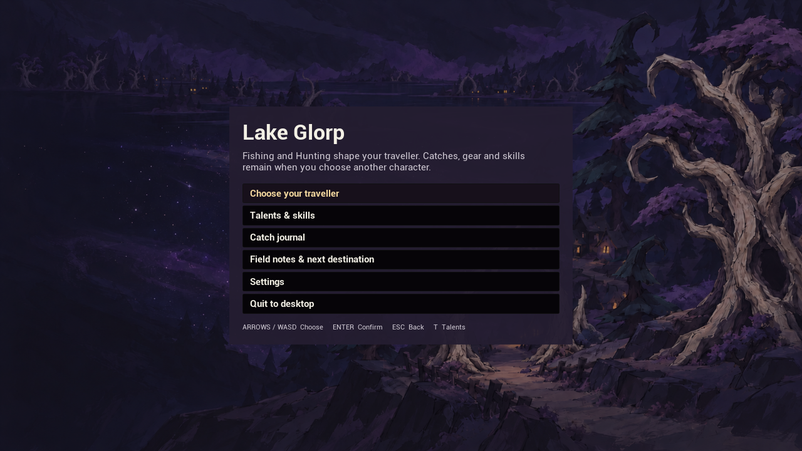
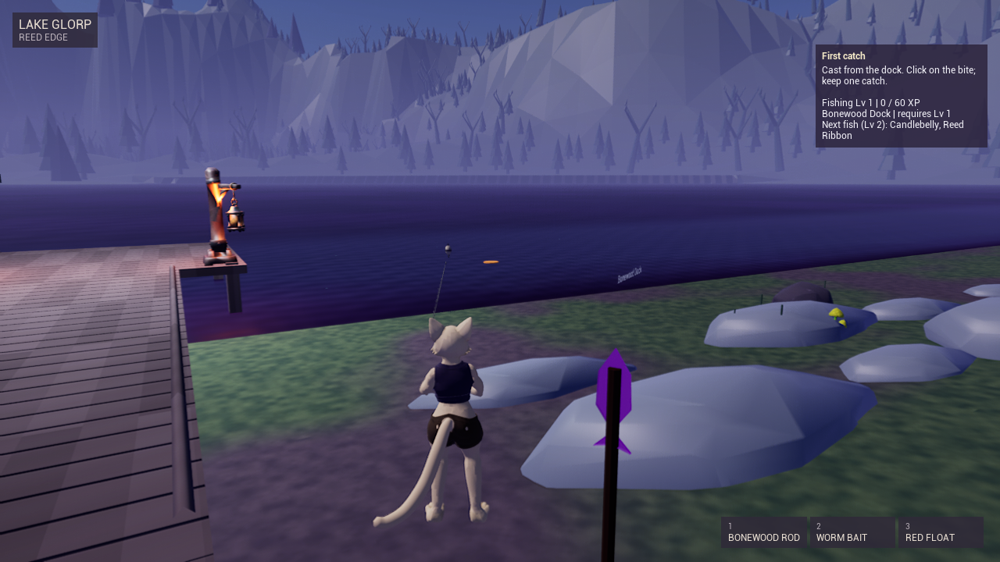

# Project Fibsh

Status: Unreal game in development. Selected packaged screenshots are public; the game repository and builds remain private.

Project Fibsh is a city cat's strange fishing vacation at Lake Glorp. The current packaged slice connects fishing, catch collection, equipment, skills, talents, character interaction, and persistent progress.

I connect gameplay design and implementation with QA-led iteration: define the behavior, build a bounded change, inspect the result, and verify the state it leaves behind. Agent-assisted implementation and human review support that workflow.

## Selected Game Snapshots

The packaged menu connects character selection, talents, the catch journal, field notes, and settings. Its illustrated background establishes the game's visual direction.

The city-cat player, rod, float, fishing area, and first-catch objective are shown in the packaged gameplay slice. Environment art and some props remain placeholder.

## Systems In Focus

- **Fishing and collection:** cast, bite, reel, catch reveal, backpack, journal, and recast, including escape and wrong-input paths.
- **Progression and equipment:** skills, talent purchases, equipment choices, route requirements, and visible feedback.
- **Character interaction:** NPC dialogue and first-catch objectives connect the next player goal to the world.
- **Persistent state:** catches, equipment, and progression are checked across save, quit, and relaunch.

[Explore Fibsh in the game portfolio](https://kintsugikoko.github.io/KintsugiKoko/game-design.html#fibsh-systems).

## Agent-Supervised Workflow

Fibsh uses a controlled workflow that separates planning, implementation, build generation, validation, and owner approval.

- Canonical product and ship-state documents establish scope, current evidence, known defects, and the next accepted action.
- Repository-level writer controls prevent overlapping production edits and require worktree and checkpoint agreement before recovery.
- Isolated build generations copy and hash scoped inputs before Unreal compile, data validation, cook, stage, package, and launch checks.
- Automated checks, deterministic packaged validation, and human-input smoke tests produce separate evidence instead of being treated as interchangeable.
- Public, financial, legal, platform, protected-branch, and final release decisions remain owner-gated.

## Recent Workflow Milestones

The current selected slice demonstrates:

- A controlled agent workflow with explicit writer ownership and recovery checkpoints
- An isolated build lane that protects source stability while collecting compile, Unreal Data Validation, cook, stage, package, and launch evidence
- Packaged fishing, collection, equipment, and progression scenarios
- Packaged-build automation checks kept separate from human-input review
- Quit/relaunch persistence validation and scoped regression checks

The selected images come from a saved packaged-game validation run. They show implemented behavior at that checkpoint, rather than a prediction about later builds. Presentation, content, and broader playtesting continue to develop.

## Senior QA / QAE Signal

- Converts product goals into bounded acceptance criteria and ranked risks
- Separates source stability, build success, automated checks, deterministic validation, and human usability review
- Tracks failures through reproducible evidence instead of relying on summary claims
- Protects unrelated WIP and private assets during build and verification work
- Uses agent assistance within explicit ownership, scope, and approval boundaries
- Reports what passed, what remains unverified, and what blocks release confidence

## Public Boundary

Selected flat images and public-safe summaries are published. No private repository URL, Unreal source, binary content, Blender source, packaged build, credential, commercial detail, internal schedule, or unreleased production record is published here.
