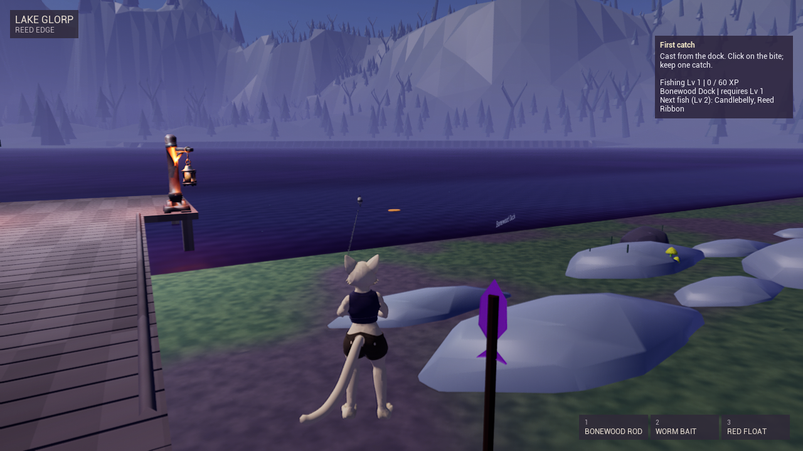
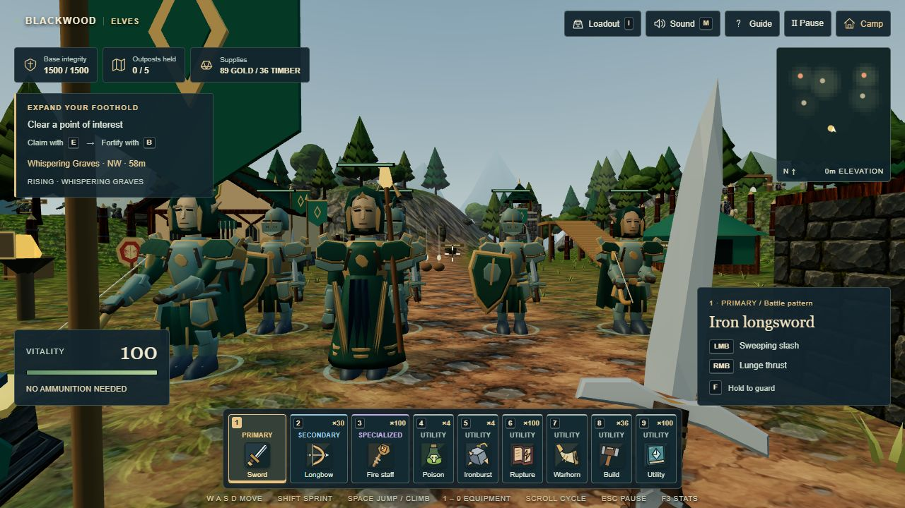

# Game Design Portfolio

This section collects public-safe examples of how I think about gameplay systems, player understanding, iteration, and design validation.

My primary professional lane is Senior QA / QAE. This game portfolio connects professional content and systems-design contributions from Ashes of Creation with current development on Project Fibsh and WARDRAGONS. It focuses on implemented systems and selected game captures.

- [Open the live Game Design Portfolio](https://kintsugikoko.github.io/KintsugiKoko/game-design.html)
- [Review the public Project Fibsh summary](../fibsh/README.md)
- [Play WARDRAGONS](https://wardragons-blackwood.mintytune.chatgpt.site)
- [Review the WARDRAGONS project overview](../wardragons/README.md)

## Design Focus

- Interconnected gameplay systems
- Equipment, economy, and progression relationships
- Player-facing clarity and feedback
- Character and visual-direction review
- Level composition and spatial readability
- Product scope and acceptance criteria
- Persistence and safe state behavior
- Playtest planning and iteration
- Translating design intent into observable behavior

## Professional Design Contribution

### Ashes of Creation Content And Systems Design

**Status:** Professional team contributions. Public summary only.

At Intrepid Studios, I contributed directly to content and systems design while working across Narrative Design and the Ashes of Creation Economy team. I was preparing to transition formally into design when the unexpected studio closure interrupted that path.

My contribution included:

- designing quest and world-event content with the Narrative Design team
- designing equipment recipes with the Economy team
- helping translate system goals, item behavior, and progression changes for an equipment rework across two milestones
- reviewing interactions between equipment, economy, progression, rewards, UI, tools, and supporting data
- identifying implementation gaps and player-facing risk during iteration
- using test coverage, playtest findings, and cross-discipline discussion to support design decisions
- communicating with design, engineering, production, art, and QA partners

This is not presented as sole design ownership. Proprietary requirements, internal documentation, tuning values, unreleased implementation details, and team-authored assets remain private.

## Current WIP Design Work

### Project Fibsh

**Status:** Unreal game in development, with selected packaged captures.

Project Fibsh is a city cat's strange fishing vacation at Lake Glorp. The current packaged slice connects fishing, collection, equipment, progression, NPC interaction, and persistent state. Its public summary shows how gameplay design, implementation, and QA-led iteration work together.

Detailed mechanics, Unreal source and content, Blender source files, packaged builds, commercial planning, and the complete validation record remain private.

## Selected Game Captures

### Project Fibsh: Fishing And Progression

[](https://kintsugikoko.github.io/KintsugiKoko/game-design.html#visual-evidence)

The packaged slice shows the city-cat player, fishing equipment, float, fishing area, and first-catch objective together. A [packaged menu capture](../../docs/assets/fibsh/fibsh-lake-glorp-menu.png) shows the connection between character selection, talents, journal, and settings. Environment art and some props remain placeholder.

### WARDRAGONS: Combat And Frontier Systems

**Status:** Playable single-player browser prototype.

[](https://wardragons-blackwood.mintytune.chatgpt.site)

WARDRAGONS connects first-person combat, equipment choices, faction allies, outpost capture, construction, and browser-local saves. Its [equipment shop](../../docs/assets/wardragons/equipment-shop.png) exposes ownership, loadout slots, and item tradeoffs.

Built with JavaScript, Three.js/WebGL, HTML/CSS, and Web Audio, it brings animation timing, projectile collision, economy, state persistence, and keyboard/touch input into one inspectable prototype. Agent-assisted implementation is paired with deterministic tests and human review.

## Design And Validation Loop

```text
Define the goal -> bound the scope -> implement one change -> validate the result -> decide the next action
```

| Design area | Purpose | Current public status |
| --- | --- | --- |
| Product and ship-state intent | Establish the current goal, accepted scope, known evidence, ranked risks, and next action | Workflow documented, product details private |
| Fibsh gameplay | Connect fishing, collection, equipment, progression, and character interaction | Selected packaged menu and gameplay captures |
| WARDRAGONS gameplay | Connect combat, equipment, economy, outposts, and persistent state | Playable browser prototype and selected gameplay/UI captures |
| Persistence behavior | Preserve understandable durable state across quit and relaunch | Validation evidence summarized, implementation private |
| System boundaries | Prevent one feature from silently owning unrelated rules or release decisions | Public workflow principle |
| Release evidence | Separate build success, automated checks, deterministic validation, and human usability review | Evidence types documented separately, no release-readiness claim |

## Product Scope And Acceptance Criteria

Canonical product and ship-state documents establish what the current change is trying to achieve, which behavior is accepted, what remains unknown, and which risks block the next decision.

That structure supports design iteration because it keeps the player-facing goal connected to observable behavior without treating a successful build or automated check as proof of a complete experience.

Questions used during review include:

- What should the player understand after this interaction?
- Which system owns the state change, feedback, and persistence rule?
- What evidence would show that the change works as intended?
- Which defects block the next milestone, and which are known WIP limits?
- What still requires human play or usability review?

## Public / Private Boundary

### What Is Public

- Scope-control and acceptance-criteria habits
- Agent-supervised writer and recovery controls
- Isolated build and validation stages
- Separation of automated, deterministic, and human evidence
- High-level gameplay, UX, and persistence iteration milestones
- Selected flattened concept boards, Blender renders, and packaged Unreal captures
- Ranked defects, residual risk, and owner-gated decisions

### What Remains Private

- Detailed mechanics and unreleased design records
- Unreal source, content, and project internals
- Blender files and final source assets
- Packaged builds and complete validation evidence
- Commercial plans, schedules, credentials, and platform details

## Design And Iteration Process

1. State the player-facing or product goal.
2. Map the systems and content responsibilities.
3. Define acceptance criteria, failure states, and known risks.
4. Implement or document the smallest controlled change.
5. Run the appropriate build, deterministic, automated, and human checks separately.
6. Distinguish observed evidence from assumptions.
7. Rank defects and approve the next action through owner review.

## Evidence And Artifacts

- [Project Fibsh Public Summary](../fibsh/README.md)
- [WARDRAGONS Project Overview](../wardragons/README.md)
- [Agent-Supervised Workflow](../fibsh/README.md#agent-supervised-workflow)
- [Recent Workflow Milestones](../fibsh/README.md#recent-workflow-milestones)
- [Published Visual Development Evidence](https://kintsugikoko.github.io/KintsugiKoko/game-design.html#visual-evidence)
- [Senior QA / QAE Signal](../fibsh/README.md#senior-qa--qae-signal)

## Publication Scope

Ashes of Creation work is described as professional team contribution. Fibsh and WARDRAGONS are in development. The public portfolio contains selected flat captures and project summaries; private source, game assets, builds, credentials, and commercial records remain outside this repository.

## Evidence Maintenance

- Keep concept, Blender, Unreal, and validation artifacts labeled by their actual maturity.
- Add only owner-reviewed flat exports, never private source files or packaged builds.
- Keep the public summary aligned with current verified milestones.
- Preserve the distinction between functional validation and release presentation.
