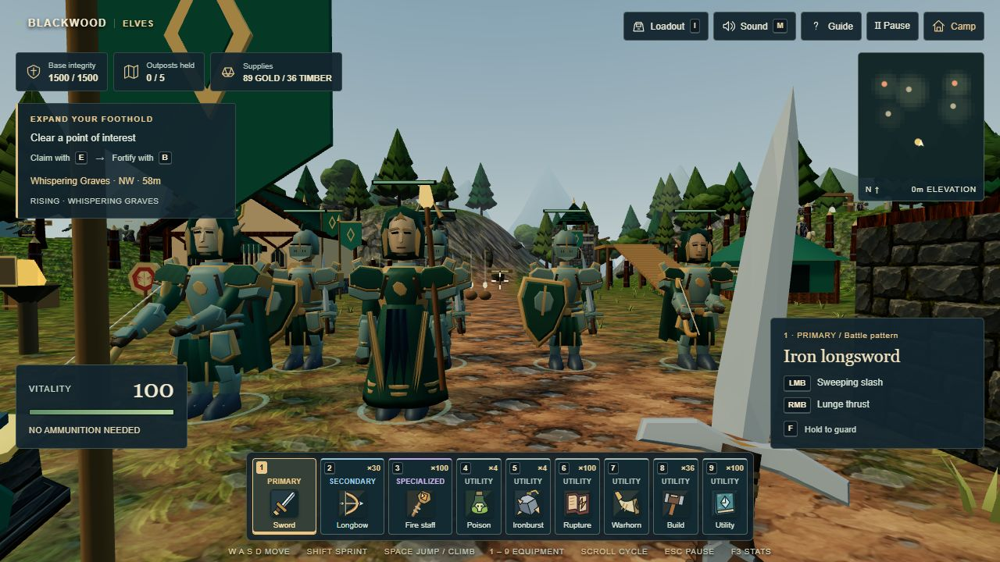
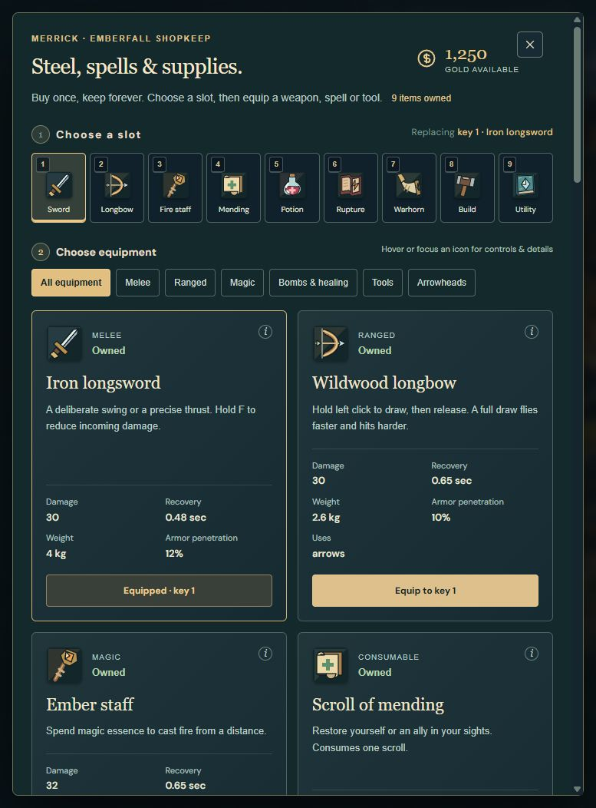

# WARDRAGONS: The Ashen Frontier

**Status:** Playable single-player browser prototype, in development.

WARDRAGONS combines first-person combat, equipment collection, outpost capture, and base defense in a stylized frontier. Choose a faction, equip at Emberfall, explore raised terrain, and turn cleared ground into a defended foothold.

**[Play WARDRAGONS](https://wardragons-blackwood.mintytune.chatgpt.site)** | **[View the game portfolio](https://kintsugikoko.github.io/KintsugiKoko/game-design.html#wardragons)**

## Selected Game Snapshots

Emberfall brings allies, faction identity, loadouts, resources, and the next outpost objective into one readable gameplay view.

The shop exposes ownership, slot assignment, equipment categories, and item tradeoffs before returning to the field.

## Connected Systems

| System | Implemented focus | QA questions |
| --- | --- | --- |
| Combat and animation | Sword contact windows, guard, bow draw/release, ammunition, and projectiles | Does damage occur at contact? Do cancelled actions consume ammunition? Does cover stop a shot? |
| Equipment and economy | Owned items, purchases, loadout slots, loot, and resupply | Can a purchase double-charge? Is a slot change consistent with owned equipment? |
| Frontier and defense | Raised terrain, traversal, outpost capture, construction, and assaults | Can collision be bypassed? Do resource deductions and structure limits remain consistent? |
| Persistence | Browser-local equipment, expedition, and world-state saves | Does returning to camp or reloading preserve the intended state? |
| Input | Keyboard/mouse and touch movement, aiming, combat, and interaction | Do pause, focus loss, resize, and equipment changes clear the correct held inputs? |

## Implementation And Workflow

JavaScript, HTML/CSS, Three.js/WebGL, Web Audio, and browser local storage. Characters, weapons, and much of the environment use procedural geometry and animation. Development combines agent-assisted implementation, deterministic tests, browser checks, and human gameplay review.

The private project includes Node test coverage for combat, movement, collision, equipment, persistence, animation constraints, and touch-input ownership. This public overview presents the game and its systems; it is not a copy of the development repository.

## Review Notes

- This is a single-player prototype. Faction allies and opponents are game-controlled units.
- Saves are local to the browser, not cloud accounts or multiplayer services.
- Performance depends on device and quality settings. Browser viewport checks are separate from physical-device testing.
- The screenshots are selected gameplay/UI captures. The live build can advance beyond these snapshots.
- Source, project assets, credentials, and internal development records stay outside this repository.
